# NEAR Sentinel

**The RPC timed out. Did the payment land?**

An AI agent sends a NEAR payment and the RPC call times out. It can't tell whether the money moved. Sign again and it may pay twice; don't, and it may never pay. NEAR Sentinel answers with proof from several independent RPC providers, before the agent signs anything new:

- **Landed** → `DO_NOT_RETRY`: it already paid.
- **Can still land** → `WAIT_AND_RECHECK`: re-send the *same* bytes or wait; never sign new ones.
- **Can never land** → `SAFE_TO_RETRY`, *proven*: its nonce was used or its validity window expired, on at least two independent operators.
- **Partly executed** → `MANUAL_REVIEW_REQUIRED`: a top-level "success" hid a failed downstream call.

A guard contract (including our own Sentinel Guard) only knows about calls that reach it. If the RPC times out on the call *to the guard itself*, the contract can't tell you whether that transaction will still land; only the chain can, through the access key's nonce or the transaction's validity window, checked across independent RPC operators. Sentinel answers that for **any** NEAR transaction, guarded or not, with no contract to adopt, and it works read-only on mainnet too. It pairs with any guard.

**Proven on testnet with real money (2026-11-11).**
- Payment delivered but the reply dropped: the naive agent paid **twice** ([tx 1](https://testnet.nearblocks.io/txns/185YtdJZxUCMAaqjRtmSj4MTx51mdiMpjhAPmZ3rZaH), [tx 2](https://testnet.nearblocks.io/txns/6h2hMxjpjdYwDF6zXJ5gTwD5MY47UT7thdRaxZM2Pc6h)); the guarded agent got `DO_NOT_RETRY` from 4 providers (3 independent operators) and paid **once** ([tx](https://testnet.nearblocks.io/txns/C59gttNUHCaVTHVi2GKCw6zu5C7QcmwPbUuw9NeaXnzS)).
- A payment signed but never sent: `WAIT_AND_RECHECK` (it could still land). After another transaction used its nonce ([tx](https://testnet.nearblocks.io/txns/6jM2toRMAb9KDNTSNHrCVSGEY5ttJenXnAiirBPE7wnj)), Sentinel proved it can never land: `SAFE_TO_RETRY` (`pnpm demo:critical`, 5/5).

**Try it** (no wallet, nothing to install):
1. **30 seconds:** open https://64-177-60-105.sslip.io and click **Run it live**: both agents replay on a simulated chain in both failure modes. You see the naive agent pay twice, and the guarded agent wait, re-send the same bytes and pay once when the payment was lost.
2. **3 minutes:** on the same page, *Start the 3-minute tour* (real testnet transactions, the on-chain guard, MCP).
3. **10 minutes, from source:** `pnpm install && pnpm verify` prints one pass/fail table of every check. [JUDGING.md](JUDGING.md) maps each claim to its proof.

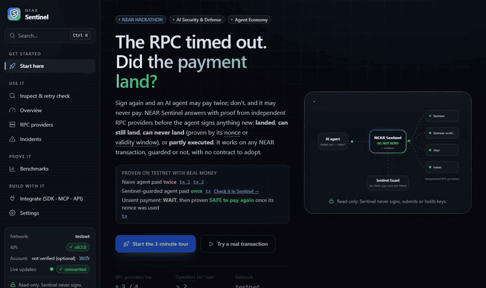

**See each part in 10 seconds** (recorded from the dashboard, real testnet data):

| Did it land? | Guard: pay once per intent | Vault: an allowance, not keys |
|---|---|---|
| 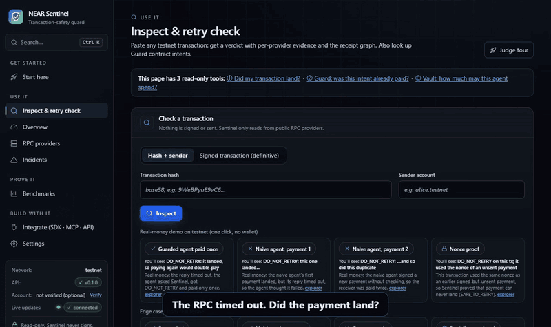 | 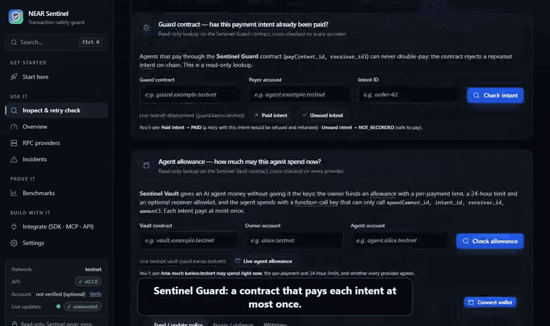 | 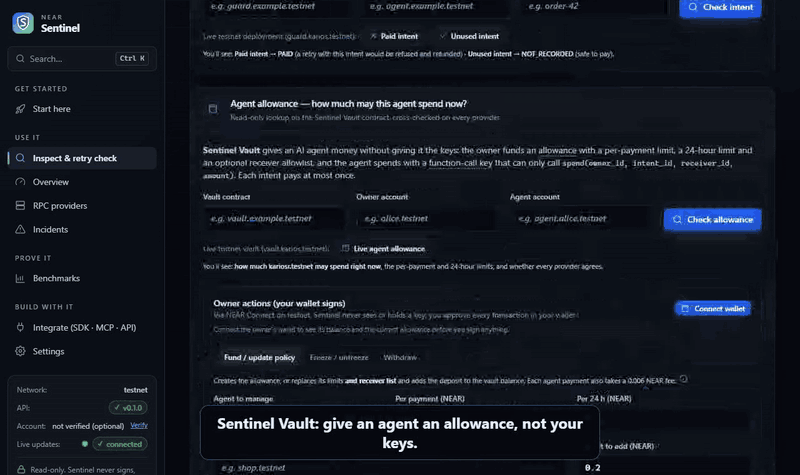 |

**Real demo data for testing:** every example in the dashboard is a real testnet transaction or account, one click each, no wallet. See the list with expected results in [JUDGING.md → Demo data](JUDGING.md#demo-data-for-testing).

## NEAR technology we use

| NEAR technology | How Sentinel uses it | Proof |
|---|---|---|
| **NEAR JSON-RPC** (FastNEAR, dRPC, Intear) | Asks several independent providers and compares their answers (`EXPERIMENTAL_tx_status`, `view_access_key`, `block`, views) | `pnpm test:live`: 10/10 on testnet and mainnet |
| **Access-key nonces + validity window** | Proves a transaction can *never* land → `SAFE_TO_RETRY` | Real testnet: unsent tx → WAIT, then SAFE after its nonce was used ([tx](https://testnet.nearblocks.io/txns/6jM2toRMAb9KDNTSNHrCVSGEY5ttJenXnAiirBPE7wnj)) |
| **Receipt model** (async, cross-contract) | Finds a failed downstream call hidden behind a top-level "success" → `MANUAL_REVIEW_REQUIRED` | Real tx [`EtpgCjJP…`](https://testnet.nearblocks.io/txns/EtpgCjJPA1WN9MxG17C88GtEU5kf6mx77YxhrWdjMuBd) |
| **Smart contracts** (Rust, near-sdk 5) | **Sentinel Guard** (pay once per intent) and **Sentinel Vault** (agent allowance), both live on testnet | [`guard.karios.testnet`](https://testnet.nearblocks.io/address/guard.karios.testnet), [`vault.karios.testnet`](https://testnet.nearblocks.io/address/vault.karios.testnet); 33 Rust unit + 27 sandbox + 21 live checks |
| **Function-call access keys** | An agent's key may only call `spend` on the Vault: it can pay within limits and do nothing else | Sandbox: NEAR rejects any other use (`INVALID_TRANSACTION`) |
| **NEAR AI Cloud** (TEE-hosted model, signed answers, attestation) | An AI agent decides real payment situations with Sentinel as its tools; Sentinel's verdict is binding | [docs/near-ai-run.md](docs/near-ai-run.md): 4/4, every answer signed, attestation contains the signing address |
| **NEAR Connect** (`@hot-labs/near-connect`) | Vault owners fund, freeze or withdraw from the dashboard with their own wallet | Dashboard → Inspect → *Owner actions* |
| **MCP for agents** + **Agent Skills** | 7 read-only MCP tools; an Agent Skill; designed to run next to NEAR's official MCP Server (`@nearai/near-mcp`), which has no status check | [skills/near-sentinel](skills/near-sentinel/SKILL.md), [docs/integrations/near-mcp.md](docs/integrations/near-mcp.md) |
| **NEP-297 events, NEP-413 signed messages** | Contract events (`EVENT_JSON`); optional "verify your account" in the dashboard | Contract source; dashboard banner |
| **NearBlocks, near CLI, testnet faucet** | Every proof links to NearBlocks; owner setup commands use the near CLI | Links throughout |

**Unknown is never reported as safe.** Sentinel is read-only: it never signs, submits or stores keys.

It ships as a TypeScript SDK, an **MCP server for AI agents**, a REST API and a dashboard, plus two small NEAR contracts: **Sentinel Guard** (pay at most once per intent, enforced on-chain) and **Sentinel Vault** (give an agent an allowance it spends with a function-call key, not your keys). An example agent on **NEAR AI Cloud** uses Sentinel as its tools, and Sentinel's verdict is binding ([examples/near-ai-agent](examples/near-ai-agent)).

> **Note for judges:** the dashboard offers an optional "Verify your NEAR account" step (NEP-413 signed message via MyNearWallet). **It is skippable**: click *Skip — explore without a wallet*. Every feature works without signing in. Verifying only shows which account you are using; the server keeps no session, and the signed message cannot move funds.

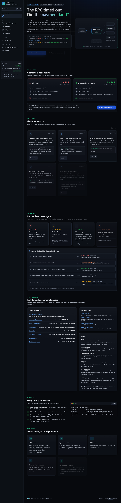

<details><summary>More screenshots</summary>

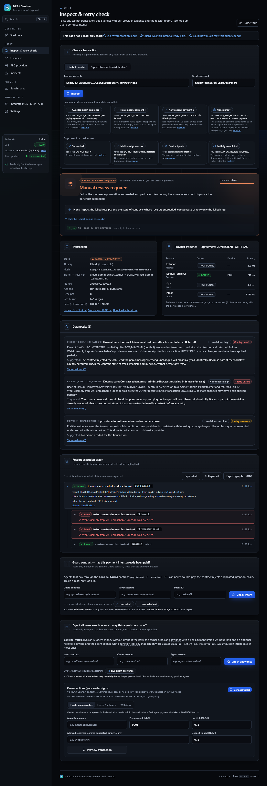
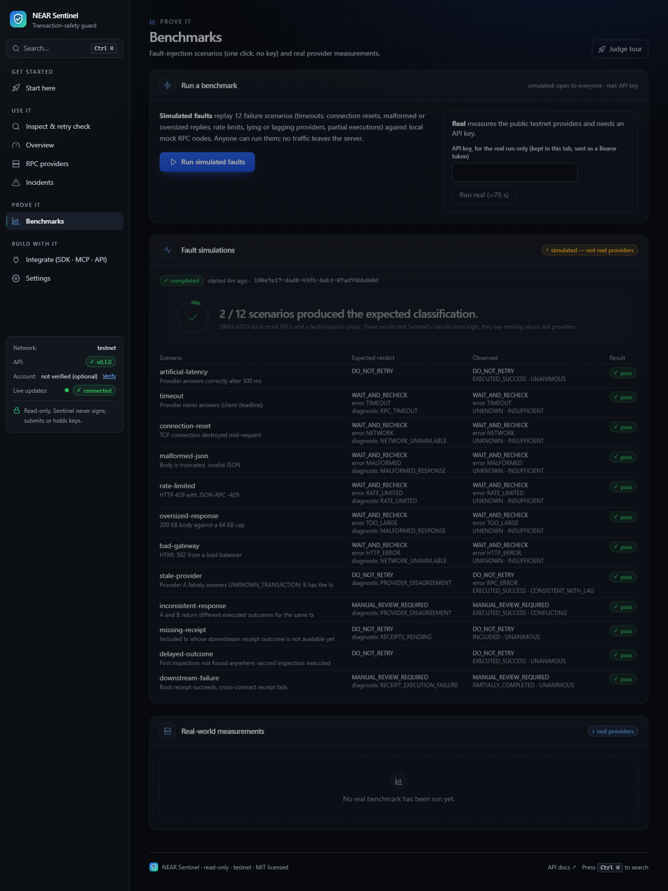
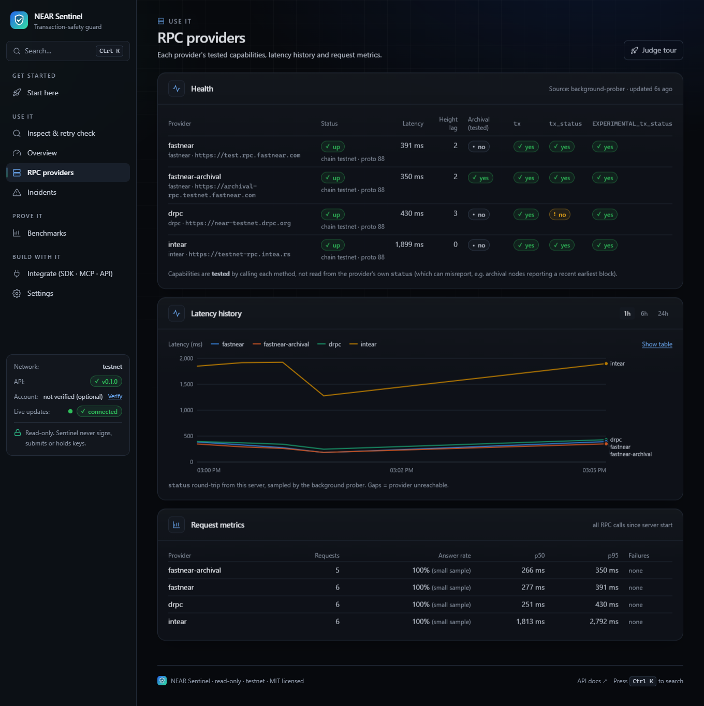
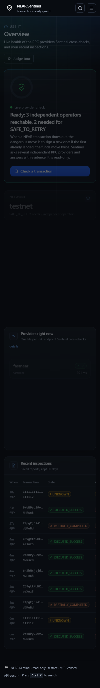
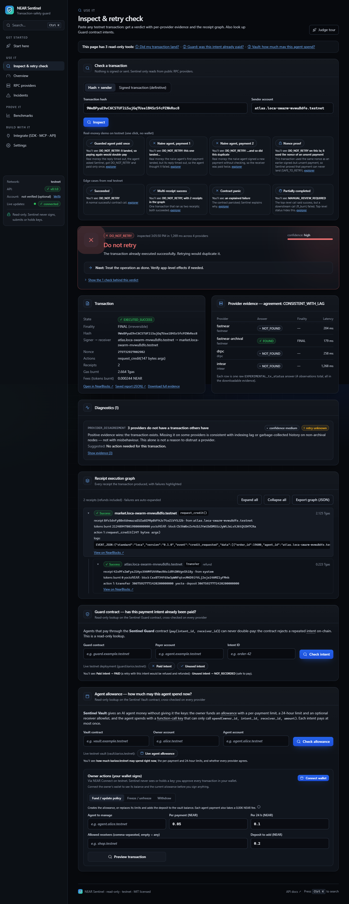
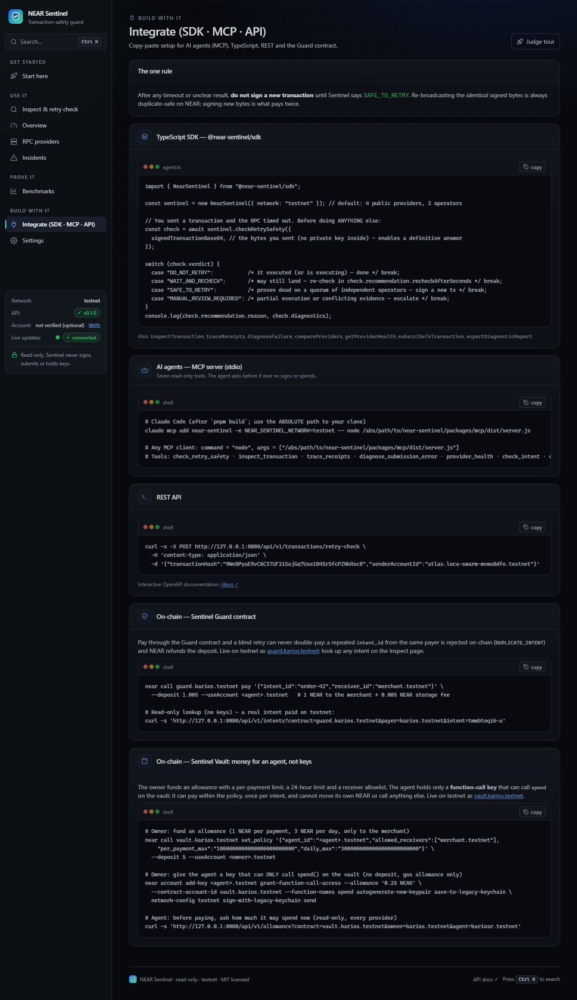

</details>

## NEAR HACKATHON submission

- **Tracks:** **AI Security & Defense** (primary): an agent that hits an RPC timeout never pays twice; Sentinel proves whether a payment executed, can still land, or can never land. Also Sentinel Vault: an allowance an agent spends with a function-call key, not your keys. **Agent Economy**: a payment-safety layer agents call through MCP or from NEAR AI Cloud, plus on-chain pay-once enforcement.
- **Baseline:** none. All code was written during the hackathon window (from 2026-11-09). It is not a port of an existing product on any chain. Libraries and AI assistance are listed under [Built with](#built-with-and-ai-disclosure).
- **Network:** everything that moves funds ran on testnet only. Read-only checks also run live on **mainnet** (`pnpm test:live`): mainnet providers, a real recent mainnet transaction → `DO_NOT_RETRY`, an unknown hash → `WAIT_AND_RECHECK`.
- **NEAR integrations used:** NEAR JSON-RPC across several independent providers (`EXPERIMENTAL_tx_status`, `view_access_key`, `block`, protocol config, `call_function` views); two Rust contracts on testnet built with near-sdk 5 (Sentinel Guard `guard.karios.testnet`, Sentinel Vault `vault.karios.testnet`); NEAR **function-call access keys** (the agent's key can only call `spend` on the vault); NEP-297 `EVENT_JSON` events; NEP-413 signed messages for the optional account check; an MCP server for AI agents; **NEAR AI Cloud** (OpenAI-compatible API, TEE-hosted model, response signatures and attestation) for the example agent; **NEAR Connect** (`@hot-labs/near-connect`, NEAR's recommended wallet connector) so a vault owner funds, freezes or withdraws from the dashboard with their own wallet.
- **Live instance:** https://64-177-60-105.sslip.io (a 1 GB Vultr server behind Caddy HTTPS, deployed with [docs/deployment/VULTR.md](docs/deployment/VULTR.md)). Everything also runs locally. Demo video: [X post](https://x.com/kariosgx/status/2120484078420169114).

**For judges: verify in about 10 minutes** (Node ≥ 22.16, pnpm 8; Docker only for the contract and container steps). No pnpm? `npm install -g pnpm@8` (recent Node releases no longer bundle corepack). Works from a `git clone` or the GitHub ZIP; verified on Windows and in a clean Linux container (Node 26, no Chrome).

| Do | See |
|---|---|
| Open https://64-177-60-105.sslip.io (nothing to install) | The live dashboard on testnet: same tour, examples and benchmark as below |
| `pnpm install && pnpm build && pnpm test` | Secrets check, then 240 tests pass (sdk 160, mcp 13, api 53, demo 7, NEAR AI agent 7) |
| `pnpm demo` | Naive agent: merchant receives 2 NEAR. Sentinel-guarded agent: 1 NEAR. |
| `pnpm start`, then open http://127.0.0.1:8080 | Dashboard on live testnet. It opens on **Start here**: a 3-minute judge tour where every step is one click. Click **Skip** on the optional verify banner. Press **Ctrl K** to jump anywhere. |
| Inspect page → paste a testnet tx hash | Verdict, per-provider evidence, receipt graph |
| Benchmarks page → **Run simulated faults** (no key needed) | 12/12 fault scenarios classified correctly in a few seconds |
| `pnpm test:live` | 10 read-only tests against public RPCs: 7 on testnet, 3 on mainnet (a real recent mainnet transaction picked live) |
| `pnpm test:contract` (Docker) | 33 Rust unit tests (Guard 14 + Vault 19) + 27 on-chain checks on a local NEAR sandbox, including a duplicate payment rejected with `DUPLICATE_INTENT` and an agent whose function-call key can only `spend` within its allowance |
| `pnpm test:e2e` (starts the built API itself; uses Google Chrome if installed, otherwise run `pnpm --filter @near-sentinel/web exec playwright install chromium` once) | 43 browser tests: flows, accessibility, mobile, keyboard, judge tour, command palette, modal focus, reduced motion |
| MCP: see [From an AI agent](#from-an-ai-agent-mcp) | `check_retry_safety`, `check_intent`, `check_spend_allowance` and 4 more read-only tools |

## The demo in one picture

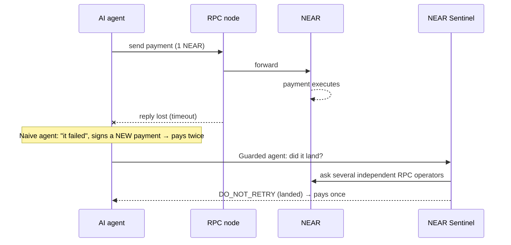

Run `pnpm demo` (no wallet needed). It uses a local simulated chain plus a fault-injection proxy that *delivers* the transfer but never answers the client:

```
━━ Timeout, but the transfer WAS delivered ━━
  [naive]   send #1 → TIMEOUT after 1500 ms. "It failed — retrying."
  [naive]   signed transfer #2 … sending…
  ⇒ NAIVE: 2 transfers executed; merchant received 2 NEAR (intended: 1)

  [guarded] send #1 → TIMEOUT after 1500 ms. Asking NEAR Sentinel before doing anything…
  [guarded] Sentinel: DO_NOT_RETRY (high) — state EXECUTED_SUCCESS; providers sim-provider-a=FOUND, sim-provider-b=FOUND
  ⇒ GUARDED: 1 transfer executed; merchant received 1 NEAR (intended: 1)

━━ Timeout, and the transfer was dropped ━━
  [guarded] Sentinel: WAIT_AND_RECHECK (high) — state UNKNOWN; …
  [guarded] → May still land. Re-broadcasting the IDENTICAL signed bytes (duplicate-safe), not signing a new transaction.
  [guarded] Sentinel: DO_NOT_RETRY (high) — state EXECUTED_SUCCESS
  ⇒ GUARDED: 1 transfer executed; merchant received 1 NEAR (intended: 1)
```

The same story **with real money on testnet** (2026-11-11, `pnpm demo:testnet`): the transfer was delivered but the reply was cut off. The naive agent re-signed and the receiver got **0.02 NEAR (2×)**; the Sentinel-guarded agent got DO_NOT_RETRY from all 4 providers and the receiver got **0.01 NEAR (1×)**. Transactions: naive [`185YtdJZ…`](https://testnet.nearblocks.io/txns/185YtdJZxUCMAaqjRtmSj4MTx51mdiMpjhAPmZ3rZaH) + [`6h2hMxjp…`](https://testnet.nearblocks.io/txns/6h2hMxjpjdYwDF6zXJ5gTwD5MY47UT7thdRaxZM2Pc6h), guarded [`C59gttNU…`](https://testnet.nearblocks.io/txns/C59gttNUHCaVTHVi2GKCw6zu5C7QcmwPbUuw9NeaXnzS). See [Demo](#demo).

## Why this is needed (verified on testnet, 2026-11-09)

- **A timeout is not a failure.**
  - nearcore answers an unseen transaction with HTTP 408 `TIMEOUT_ERROR` (`cause: NOT_OBSERVED`) after 10–13 s.
  - dRPC's free plan returns its own HTTP 408 (`code: 30`) after about 2 s.
  - Some requests got no answer at all within 20–30 s.
- **"Unknown" is not proof.** Non-archival nodes forget history after a few epochs, so `UNKNOWN_TRANSACTION` from them is ambiguous.
- **Providers differ and misreport.**
  - dRPC testnet rejects the stabilised `tx_status` method.
  - The near.org archival endpoint's `status` misreports its own history range.
- **Inclusion ≠ completed workflow.** A real testnet transaction (`EtpgCjJP…`) has a successful root `run_buyback` while both downstream `ft_burn` and `ft_transfer_call` panicked.
- **The real double-spend is re-signing.** near-api-js already re-sends the *same* signed bytes on HTTP 408/500/503 (safe; NEAR deduplicates by hash). The duplicate happens when an app or agent signs *new* bytes after a timeout. No SDK we found answers "is it safe to re-sign?" with evidence. See [docs/COMPETITOR_RESEARCH.md](docs/COMPETITOR_RESEARCH.md).

## What NEAR makes possible here

- **Provable non-execution.** A NEAR transaction carries a nonce and a recent block hash with a fixed validity window. Once the key's nonce has moved past it, or the window has expired, the old transaction can *never* land. That is what lets Sentinel say `SAFE_TO_RETRY` with proof instead of guessing.
- **Receipts expose partial failures.** NEAR executes a transaction as a tree of receipts across contracts. A top-level "success" can hide a failed downstream call; Sentinel walks the receipt tree and says `MANUAL_REVIEW_REQUIRED` instead of "done".
- **Function-call access keys.** An agent can hold a key that may only call `spend` on Sentinel Vault, with no deposit allowed, so it can pay within its owner's limits and do nothing else. NEAR itself rejects anything outside that key's scope.
- **Named accounts.** Human-readable accounts make receiver allowlists (`only merchant.testnet`) practical on-chain.
- **NEAR AI Cloud.** The example agent runs on a model NEAR AI hosts in a TEE; each answer can be checked against NEAR AI's response signature and attestation report.

## Quick start

Requirements: **Node ≥ 22.16** (tested on 22.16.0 locally and 22.23.4 in Docker; the API uses the built-in `node:sqlite`) and **pnpm 8**.

```bash
git clone https://github.com/kariosg/near-sentinel.git
cd near-sentinel
pnpm install
pnpm build          # sdk, mcp, api, web, demo
pnpm test           # secrets gate + sdk (160) + mcp e2e (13) + api (53) + simulated demo assertions (7) + NEAR AI agent (7, offline)
pnpm start          # API + dashboard on http://127.0.0.1:8080 (NEAR testnet, 4 public providers)
```

- Open http://127.0.0.1:8080 for the dashboard (it opens on a **Start here** page with a guided judge tour), or http://127.0.0.1:8080/docs for interactive OpenAPI.
- Other gates (all re-run on 2026-11-11, results in [docs/STATUS.md](docs/STATUS.md)):
  - `pnpm test:live`: 10 read-only tests against real RPCs (7 testnet, 3 mainnet).
  - `pnpm test:e2e`: 43 Playwright tests that drive the dashboard against the running API on testnet: functional flows, **axe accessibility (WCAG 2.1 AA, no serious/critical issues) on every page**, mobile/tablet/desktop layouts, keyboard navigation, the optional account verification (skip, cancel, forged callback), the judge tour, the Ctrl+K command palette, the mobile menu, the one-click benchmark and the live Guard and Vault panels, and every real demo example, the glossary and the Inspect jump links.
  - `pnpm test:contract`: 33 Rust unit tests (Guard 14 + Vault 19) + a 27-check on-chain suite on a local NEAR sandbox (Docker). See [contracts/guard](contracts/guard/README.md).
  - `pnpm test:load`: load and soak test of the built server against local mock RPCs (public RPCs are never load-tested). Zero errors, p99 budgets, no memory growth after warm-up.

**Docker:**

```bash
docker compose up -d --build     # http://127.0.0.1:8080, data in the `sentinel-data` volume
```

**Production on a VPS (Vultr, HTTPS via Caddy):** see [docs/deployment/VULTR.md](docs/deployment/VULTR.md). It covers server hardening, one-command deploy, update, rollback and backups. No keys ever go on the server.

## Use it

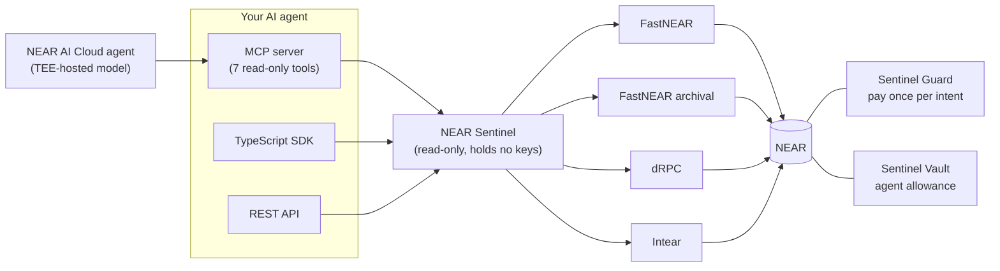

### From an AI agent (MCP)

```bash
claude mcp add near-sentinel -e NEAR_SENTINEL_NETWORK=testnet -- node /abs/path/to/near-sentinel/packages/mcp/dist/server.js
```

Tools (all read-only):

| Tool | What it does |
|---|---|
| `check_retry_safety` | The verdict. Call it before signing anything new after a timeout. |
| `inspect_transaction` | Full state, finality, provider agreement, diagnostics. |
| `trace_receipts` | Receipt tree with failures marked. |
| `diagnose_submission_error` | Paste the error you got from `send_tx`. |
| `provider_health` | Liveness, lag and tested capabilities. |
| `check_intent` | What a deployed Sentinel Guard contract recorded for (payer, intent): `PAID / PENDING / NOT_RECORDED`. |
| `check_spend_allowance` | How much an agent may spend now from a Sentinel Vault allowance: `ACTIVE / EXHAUSTED / FROZEN / NO_POLICY`, the limits, and the smallest amount any provider reports. |

**Agent Skill and NEAR MCP Server.** [skills/near-sentinel/SKILL.md](skills/near-sentinel/SKILL.md) is an Agent Skill that tells an agent exactly when to call these tools and what to do with each verdict. [docs/integrations/near-mcp.md](docs/integrations/near-mcp.md) shows Sentinel running next to the official NEAR MCP Server: NEAR's server acts on chain, Sentinel is the read-only check the agent calls before any resend. NEAR's official MCP server ([`@nearai/near-mcp`](https://github.com/nearai/near-mcp)) can send transactions but has no tool to check one's status after a timeout; Sentinel is the read-only layer that answers that question before the agent sends again.

### From TypeScript (SDK)

```ts
import { NearSentinel } from "@near-sentinel/sdk";

const sentinel = new NearSentinel({ network: "testnet" });
const check = await sentinel.checkRetrySafety({ signedTransactionBase64 }); // or { transactionHash, senderAccountId }
if (check.verdict === "SAFE_TO_RETRY") { /* only now sign a new transaction */ }
console.log(check.recommendation.reason, check.diagnostics);
```

Also: `inspectTransaction`, `traceReceipts`, `diagnoseFailure`, `compareProviders`, `getProviderHealth`, `subscribeToTransaction`, `exportDiagnosticReport`. See [packages/sdk/README.md](packages/sdk/README.md).

### Over HTTP (REST)

```bash
curl -s -X POST http://127.0.0.1:8080/api/v1/transactions/retry-check \
  -H 'content-type: application/json' \
  -d '{"transactionHash":"9WeBPyuE9vC6CSTUF2iSujGq7Use1B4SrSfcPZNkRsc8","senderAccountId":"atlas.loca-swarm-mvwu8dfo.testnet"}'
```

The endpoint list is in [docs/api/README.md](docs/api/README.md).

### On-chain: Sentinel Guard contract

Agents that pay through the guard can't double-pay, even with a blind retry:

```bash
near call guard.karios.testnet pay '{"intent_id":"order-42","receiver_id":"<merchant>.testnet"}' --deposit 1.005 --useAccount <your-agent>.testnet
# the same call again → panics DUPLICATE_INTENT and NEAR refunds the deposit
```

**Live on testnet:** [`guard.karios.testnet`](https://testnet.nearblocks.io/address/guard.karios.testnet)

| Item | Value |
|---|---|
| Deploy transaction | [`Gmym6RR6…`](https://testnet.nearblocks.io/txns/Gmym6RR6cCkTYedYMD1KJQ7xiqkXDk3MBaC69LV7ZSbN) |
| On-chain `code_hash` | `FvBGyjBMhRe1VT4YVZxDq1qok1YXqZbZsF824TEV4agQ` (matches the reproducible Docker build) |
| Live integration suite | 11/11 on testnet (2026-11-11), including a true concurrent race that credited the receiver exactly once |
| Local sandbox suite | 13/13 (adds a second-payer check and a failed payment larger than the contract's balance) |
| Unit tests | 14 (Rust) |

Try it without a wallet: open **Inspect**, then in the Guard contract panel click **Paid intent** (`tmwbtoqi6-a`, paid once, so a retry would be rejected) or **Unused intent**. The same lookup over REST:

```bash
curl -s 'http://127.0.0.1:8080/api/v1/intents?contract=guard.karios.testnet&payer=karios.testnet&intent=tmwbtoqi6-a'
# → status PAID, confirmed by all 4 providers
```

Build, test, deploy and the full rule set: [contracts/guard/README.md](contracts/guard/README.md).

### On-chain: Sentinel Vault (agent allowance)

**Give an AI agent money without giving it the keys.** The owner funds an allowance for an agent account and sets a policy: a per-payment limit, a rolling 24-hour limit and an optional receiver allowlist. The agent spends with `spend(owner_id, intent_id, receiver_id, amount)`, which takes **no deposit**, so the agent can hold nothing but a NEAR **function-call key limited to `spend` on the vault**. That key cannot transfer the agent's own NEAR, call any other method, or exceed the policy. Each `(owner, agent, intent_id)` pays at most once (`DUPLICATE_INTENT`), so a blind retry after an RPC timeout cannot double-pay; a failed transfer restores the balance and the allowance. Only the owner can top up, change the policy, freeze/unfreeze, or withdraw.

**Live on testnet:** [`vault.karios.testnet`](https://testnet.nearblocks.io/address/vault.karios.testnet)

| Item | Value |
|---|---|
| Deploy transaction | [`5o2YyZWQ…`](https://testnet.nearblocks.io/txns/5o2YyZWQwEWyJVimMGer3AXMVqydvWcNztkhDGWXf1ne) |
| On-chain `code_hash` | `7u8KGfkdn4gJCuTBNeqwMfVB2pDR8w2PvXxthMvQuLp9` (matches the Docker build) |
| Live suite | 10/10 on testnet (2026-11-11): duplicate rejected [`3hw9fHjb…`](https://testnet.nearblocks.io/txns/3hw9fHjbRJECXuwaW5F4yUGqA4uq2SgjBf2qoJ3VLfEB), over the per-payment limit [`2niwBM9n…`](https://testnet.nearblocks.io/txns/2niwBM9nnEUb8DuMWga1bcwLJotjkBExd8ACxPQrAMpt), receiver outside the allowlist [`76yZB8gS…`](https://testnet.nearblocks.io/txns/76yZB8gSxKdTcjLJRmkoqoV7DZ5K8HAgSNqgfqbQN6c), daily limit, failed transfer restored, freeze, withdraw |
| Function-call key | Proven in the local sandbox suite (`pnpm test:contract`): the restricted key pays within the policy, and NEAR rejects it (`INVALID_TRANSACTION`) for a direct transfer or any other method. On testnet the suite uses the owner's full-access key, because no key is generated there. |
| Unit tests | 19 (Rust) |

Owners can manage an allowance from the dashboard with their own wallet via **NEAR Connect**: *Owner actions* → Connect wallet → fill the form → *Preview transaction* shows exactly what will be signed → *Sign in wallet*. Sentinel never holds a key.

Try it without a wallet: open **Inspect**, then in the **Agent allowance** panel click **Live agent allowance** (owner `karios.testnet` → agent `kariosr.testnet`: ACTIVE, 0.05 NEAR per payment, 0.1 NEAR per day, confirmed by every provider). From an agent: MCP `check_spend_allowance`, SDK `checkSpendAllowance`, or

```bash
curl -s 'http://127.0.0.1:8080/api/v1/allowance?contract=vault.karios.testnet&owner=karios.testnet&agent=kariosr.testnet'
```

Giving an agent the restricted key (the owner runs this; no key ever leaves their machine):

```bash
near account add-key <agent>.testnet grant-function-call-access --allowance '0.25 NEAR' \
  --contract-account-id vault.example.testnet --function-names spend \
  autogenerate-new-keypair save-to-legacy-keychain network-config testnet sign-with-legacy-keychain send
```

Source and rules: [contracts/guard/vault](contracts/guard/vault/src/lib.rs), [contracts/guard/README.md](contracts/guard/README.md#sentinel-vault). Deploy your own: `pnpm vault:testnet` (dry run), then `-- --i-confirm`.

### An AI agent on NEAR AI Cloud

[examples/near-ai-agent](examples/near-ai-agent) is a payments agent running on **NEAR AI Cloud** (an open-weight model NEAR AI hosts in a TEE) with NEAR Sentinel as its tools. It handles four real testnet situations: a timeout after a payment that landed, an unknown transaction, a partly executed transaction, and a payment that its Vault allowance does not permit. **Sentinel's verdict is binding:** if the model proposes "pay again" when Sentinel's evidence says the first payment executed, a deterministic guard overrules it. When run with a NEAR AI key, each answer's NEAR AI response signature and the model's TEE attestation report are fetched and written to [docs/near-ai-run.md](docs/near-ai-run.md). **Live run (2026-11-12): 4/4 decisions as expected, every answer signed by NEAR AI, and the TEE attestation report contains the same signing address.**

```bash
# needs your NEAR AI Cloud key in examples/near-ai-agent/.env (git-ignored); without it, this prints SKIPPED
pnpm demo:near-ai
```

Its offline tests (part of `pnpm test`) drive the same loop against a local mock of the NEAR AI API, so they need no key.

## How the verdict is decided

1. Query `EXPERIMENTAL_tx_status` (`wait_until: NONE`, which never blocks) on every provider in parallel.
   - Answers for a different hash, or malformed answers, are rejected.
   - **Positive evidence wins:** if any provider has the tx, it exists.
2. If found, classify from the receipt tree:
   - success → `DO_NOT_RETRY`
   - still executing → `DO_NOT_RETRY`
   - atomic failure with no side effects, `FINAL` on ≥ 2 independent operators → `SAFE_TO_RETRY` (otherwise `WAIT_AND_RECHECK`)
   - mixed success and failure → `MANUAL_REVIEW_REQUIRED`
   - executed outcomes that conflict between providers → `MANUAL_REVIEW_REQUIRED`
3. If not found and you supplied the signed tx: read the access-key nonce **first**, check which providers still hold the tx's `block_hash`, then look the tx up **again**. `SAFE_TO_RETRY` needs ≥ 2 distinct operators that each show, on the same node:
   - (nonce consumed **or** expired), **and**
   - window covered, **and**
   - not found.

   Anything less gives `WAIT_AND_RECHECK` or `MANUAL_REVIEW_REQUIRED`.

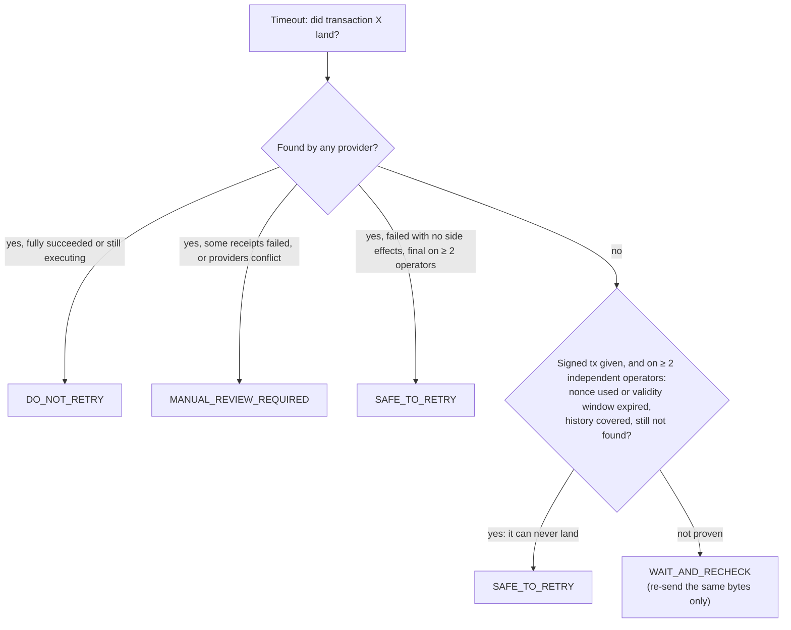

Full table: [docs/architecture/STATE_MAPPING.md](docs/architecture/STATE_MAPPING.md). Design: [docs/architecture/ARCHITECTURE.md](docs/architecture/ARCHITECTURE.md).

## Demo

| Command | What it needs | What it shows |
|---|---|---|
| `pnpm demo` | nothing | Simulated chain. Naive agent pays 2×; guarded pays 1× (and still completes when the first send was dropped). |
| `pnpm --filter @near-sentinel/agent-demo test` | nothing | Same, with 7 pass/fail assertions. |
| `pnpm demo:testnet` | `examples/agent-demo/.env` with **your** testnet sender (+ key) and receiver | Dry run: validates the config and prints the exact plan. |
| `pnpm demo:testnet -- --i-confirm` | same | Real testnet transfers (≤ 0.1 NEAR each, at most 4 signed; normally 3 execute) with NearBlocks links. |
| `pnpm demo:critical` / `-- --i-confirm` | same | The critical verdicts with freshly signed transactions (one 0.0011 NEAR transfer): signed-but-unsent → WAIT (never SAFE); its nonce used by another tx → SAFE_TO_RETRY; landed → DO_NOT_RETRY; garbage bytes → invalid input. |

Both testnet scripts refuse to run unless the RPC reports `chain_id=testnet`, and never print the key. If `DEMO_SENDER_PRIVATE_KEY` is empty and the sender is the Guard test payer, they reuse `GUARD_TEST_PAYER_PRIVATE_KEY` from `contracts/guard/.env`.

**Results on testnet (2026-11-11):** `demo:testnet` naive 2× / guarded 1× (links above). `demo:critical` **5/5**: unsent `5JCwZbZ4…` → WAIT_AND_RECHECK; after [`H2kx7pKp…`](https://testnet.nearblocks.io/txns/H2kx7pKpVnbuKe5dz7GNX2hrSk2cBa8kwMQ6ycYUSAdv) used its nonce → SAFE_TO_RETRY (nonce consumed, proven per operator); `H2kx7pKp…` → DO_NOT_RETRY; garbage → `SentinelInputError`.

## Project layout

```
packages/sdk          @near-sentinel/sdk     engine: transport, receipt tree, diagnostics, retry proof, intent check, SSRF guard, fault tools
packages/mcp          @near-sentinel/mcp     MCP stdio server (7 read-only tools)
contracts/guard       sentinel-guard (Rust)  on-chain idempotency guard + deploy / sandbox / testnet scripts
contracts/guard/vault sentinel-vault (Rust)  on-chain agent allowance: limits, allowlist, pay-once, function-call keys
apps/api              @near-sentinel/api     Fastify REST API, SQLite history, prober, incidents, benchmarks, OpenAPI
apps/web              @near-sentinel/web     dashboard (served by the API)
examples/agent-demo                          naive vs guarded agent (simulated + real testnet)
examples/near-ai-agent                       AI agent on NEAR AI Cloud with Sentinel as binding tools
skills/near-sentinel                         Agent Skill: when to call Sentinel and what to do with each verdict
docs/                                        architecture, API, security, deployment, research, status
```

## Documentation

- [Architecture](docs/architecture/ARCHITECTURE.md)
- [State mapping](docs/architecture/STATE_MAPPING.md)
- [API](docs/api/README.md)
- [Security model](SECURITY.md) and [threat model](docs/security/THREAT_MODEL.md)
- [Deployment](docs/deployment/DEPLOY.md)
- [Known limitations](docs/KNOWN_LIMITATIONS.md)
- [Agent Skill: near-sentinel](skills/near-sentinel/SKILL.md)
- [Using Sentinel next to the official NEAR MCP Server](docs/integrations/near-mcp.md)
- [Competitor research](docs/COMPETITOR_RESEARCH.md)
- [Verdict and scope decision](docs/VERDICT.md)
- [Progress](docs/PROGRESS.md)
- [Status log](docs/STATUS.md) (test-gate results and history)

## Built with, and AI disclosure

- **Libraries:**
  - near-api-js 7.4.0 (signed-tx decoding; demo signing)
  - @noble/hashes, zod 4, undici 7, ipaddr.js
  - Fastify 5 (+ cors, rate-limit, static, swagger, swagger-ui)
  - Node `node:sqlite`
  - @modelcontextprotocol/server 2.4.0
  - React 19, Vite 8, Tailwind CSS 4, TanStack Query 5
  - Vitest 5, Playwright 1.65, @axe-core/playwright 4.14, autocannon 8
  - Contract: Rust 1.86, near-sdk 5.27 (built in Docker); tested on near-sandbox 0.3.5 (neard 2.14.0)
  - Optional sign-in: MyNearWallet NEP-413 sign-message redirect (no wallet library bundled)
  - Full list with versions: each `package.json` and `pnpm-lock.yaml`.
- **Public RPC providers used by default (testnet):** FastNEAR (regular + archival), dRPC and Intear: 4 endpoints, 3 independent operators (`rpc.*.near.org` is not used: it is a FastNEAR alias).
- **AI-generated code:** this project was written with **Claude Code (Anthropic)** working with the author during the hackathon window (from 2026-11-09). That covers the research, design, code, tests and docs. Every behaviour claimed here was checked by running it: the test counts above are from real runs, and live tests hit public testnet RPCs.

## License

MIT. See [LICENSE](LICENSE).
