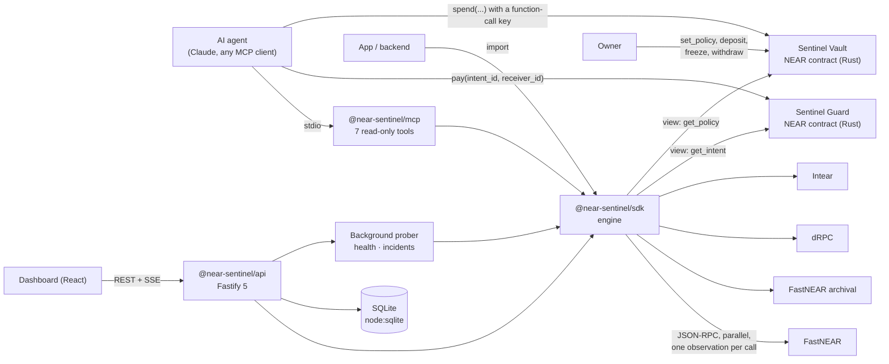

# Architecture

## Components

**`packages/sdk`: the engine.** Pure TypeScript, ESM, no framework.

| Module | Responsibility |
|---|---|
| `rpc.ts` | One request → one `RpcObservation` (timing, HTTP status, parsed error). Never retries, never throws on network failure, caps response size, distinguishes timeout / 408 / 429 / network / malformed / oversized / JSON-RPC error / caller abort. |
| `outcome.ts` | Pure functions: receipt DAG from `EXPERIMENTAL_tx_status`, refund detection, failure flattening, state classification, outcome digest. |
| `diagnostics.ts` | Rule-based diagnostics, each citing the observation or receipt it came from. Includes submission-error classification (nearcore `TIMEOUT_ERROR` causes, `InvalidTxError` variants, dRPC shapes). |
| `retry.ts` | Pure decision function over gathered evidence (see [STATE_MAPPING.md](STATE_MAPPING.md)). |
| `sentinel.ts` | Orchestration: input validation, signed-tx decoding, phased fan-out with correct ordering, answer validation, agreement, read failover, capability probing, subscription, report export. |
| `intent.ts` | Sentinel Guard intent lookups (`checkIntent`), `privateIntentId` (HMAC id so no order number goes on-chain) and `intentIdPrivacyWarning`. |
| `vault.ts` | Sentinel Vault: allowance decision (`checkSpendAllowance`, smallest `available_now` wins), the spend preflight (`decideSpendPreflight`: the contract's `spend()` checks in the same order, never ALLOWED above `available_now`) and the allowance safety score. |
| `keys.ts` | Agent key audit (`view_access_key_list` + `view_account` on every provider): grades each key; when providers disagree the riskiest answer wins. |
| `ssrf.ts` | URL policy and a guarded `fetch` that re-checks the IP at connect time. |
| `metrics.ts` | Rolling per-provider counters and latency percentiles. |
| `testing.ts` | Scriptable mock RPC and a fault-injection proxy (`delay`, `hang`, `forward-then-hang`, `reset`, `malformed`, `rate-limit`, `http-502`, `oversized`, `stale-unknown-tx`). |

**Why a hand-written transport instead of `@near-js/jsonrpc-client`:** the official client retries internally (3×) and normalises failures. Sentinel needs each raw answer, with its latency and failure kind, as evidence. near-api-js is used only to decode signed transactions (`decodeSignedTransaction`, `encodeTransaction`) and by the demo to sign.

**`packages/mcp`.** A stdio MCP server built on `@modelcontextprotocol/server` 2.4.0. Every tool returns a short verdict text for the model plus full `structuredContent`. Tools are annotated `readOnlyHint: true`. All logging goes to stderr.

**`apps/api`.** Fastify 5.
- Zod is the single validator; route JSON schemas exist only for OpenAPI.
- SQLite via `node:sqlite` with numbered migrations. Tables: `provider_samples`, `incidents`, `reports`, `benchmark_runs`, `audit_log`, `custom_providers`.
- Privacy: `audit_log` stores client IPs only as a salted HMAC (`AUDIT_IP_SALT`, else random per process); retention runs at start-up and hourly (samples 7 days, reports and audit log 30 days) with `secure_delete`. Request logs carry no client IP (see [PRIVACY.md](../PRIVACY.md)).
- Background prober: status every 30 s, capabilities every 10 min. Incidents open after 2 consecutive bad samples and close on recovery.
- Single-flight de-duplication of identical concurrent inspections.
- SSE stream. Prometheus on a separate localhost-only listener.
- Serves the built dashboard.

**`apps/web`.** React 19 + Tailwind 4 + TanStack Query.
- Each status shows its source and freshness.
- The chart palette was validated for colour-vision deficiency against the dark surface.

**`contracts/guard`: Sentinel Guard (Rust, near-sdk 5).** Enforces "pay at most once per (payer, intent_id)" on-chain.
- `pay(intent_id, receiver_id)` records the intent, then forwards the deposit minus a storage fee. A duplicate intent panics, so NEAR refunds the deposit.
- If the transfer fails, the callback releases the intent and refunds, so the same intent can be retried.
- Views: `get_intent`, `storage_fee`, `version`. No owner, admin or upgrade method.
- The SDK's `checkIntent` and the MCP `check_intent` tool read it; Sentinel itself never calls `pay`.

**`contracts/guard/vault`: Sentinel Vault (Rust, near-sdk 5).** An owner-funded allowance for an agent: "give AI money without giving it the keys".
- The owner sets a per-payment limit, a rolling 24-hour limit and an optional receiver allowlist, and can top up, freeze or withdraw.
- The agent calls `spend(owner_id, intent_id, receiver_id, amount)` with no deposit, so it can hold only a function-call key limited to `spend`. Each `(owner, agent, intent_id)` pays at most once; a failed transfer restores the balance and allowance.
- Views: `get_policy` (with `available_now`), `get_spend`, `record_fee`, `version`. No admin or upgrade method.
- The SDK's `checkSpendAllowance`, the MCP `check_spend_allowance` tool and `GET /api/v1/allowance` read it (the smallest `available_now` any provider reports wins).
- Before an agent signs, `preflightSpend` / MCP `preflight_spend` / `GET /api/v1/spend-preflight` runs the same checks as `spend()` (advisory; the contract stays the final judge), and `auditAgentKeys` / `audit_agent_keys` / `GET /api/v1/agent-keys` checks that the agent holds no full-access key.

**`examples/agent-demo`.** Naive vs guarded agents.
- The simulated chain enforces nonces and hash de-duplication.
- The real-testnet runner has safety gates.

## Decisions (and why)

| Decision | Reason |
|---|---|
| Read-only product | Signing or submitting for users would make Sentinel a custodian and an attack target. The verdict is what's missing; signing already exists. |
| `wait_until: NONE` only | Blocking waits behave differently per provider and sometimes never return. Polling is under our control. |
| Positive evidence wins | A tx that one provider has exists. Absence elsewhere is lag or GC, not proof. |
| Proof per node, then across operators | "Nonce consumed" on node A plus "not found" on lagging node B proves nothing. Each node must show the whole proof itself. |
| Operator labels | FastNEAR's two hostnames are one company: one witness. |
| SQLite instead of Postgres/Redis | Zero setup for judges and small deployments. The data volume is small (samples kept 7 days, reports 30 days). |
| Separate real and simulated benchmarks | Simulated results test the classifier, not providers. They are stored with `kind` and never mixed. |
| No receipt-explorer clone | NearBlocks already has one. Sentinel shows a compact tree for diagnosis and links out. |
